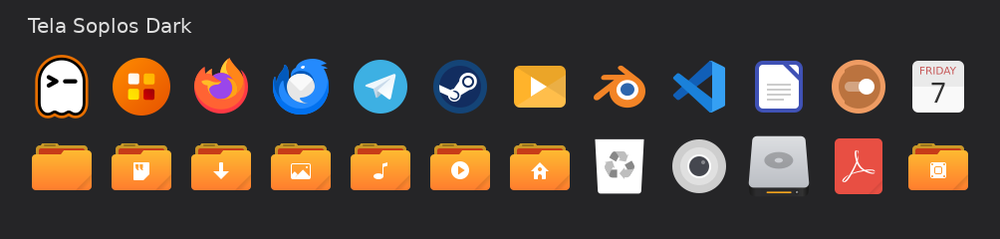
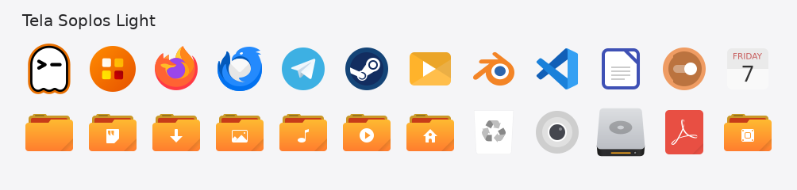

# Tela Soplos Icons

Icon themes for Soplos Linux, derived from the Tela icon theme (ubuntu variant) and recolored with the official Soplos palette.

Three variants are provided:

| Theme | Folder | Inherits |
|-------|--------|----------|
| Tela Soplos | `tela-soplos` | `hicolor,Adwaita,breeze` |
| Tela Soplos Dark | `tela-soplos-dark` | `tela-soplos,hicolor,Adwaita,breeze-dark` |
| Tela Soplos Light | `tela-soplos-light` | `tela-soplos,hicolor,Adwaita,breeze` |

`tela-soplos` holds the shared icons. The dark and light variants only add their own symbolic, action and panel icons and link to the rest, so all three folders must be installed together.

## Preview

Tela Soplos Dark, on a dark background:

Tela Soplos Light, on a light background:

The previews show a sample of the apps, folders, devices and file types. They are rendered from the SVG files of each theme.

## What is included

- Scalable SVG icons with `@2x` variants for HiDPI screens.
- Symbolic icons that follow the color scheme of the desktop.
- Soplos orange (`#ff7d2e`) as accent color for folders and system icons. Every folder icon has the Soplos gradient (orange to yellow, with a dark orange tab), different from Tela ubuntu: the color variants of Tela are removed. Third-party app icons keep their colors.
- Soplos logos, Soplos Ghostty and Soplos Launcher icons.
- Works with GNOME, KDE Plasma, Xfce and any desktop that follows the freedesktop icon theme specification.

## Installation

### Debian package (Debian, Ubuntu and derivatives)

The `.deb` package of every version is published in the [Releases](https://github.com/SoplosLinux/tela-soplos-icons/releases) of this repository.

1. Download the latest `tela-soplos-icons_<version>_all.deb` from the Releases page.
2. Install it with `apt`, which also installs the dependencies:

       sudo apt install ./tela-soplos-icons_<version>_all.deb

3. Select the theme in the settings of your desktop: Tela Soplos, Tela Soplos Dark or Tela Soplos Light.

To remove the themes, run `sudo apt remove tela-soplos-icons`.

### Manual installation

Copy the three folders to `/usr/share/icons` and refresh the caches:

    gtk-update-icon-cache -f /usr/share/icons/tela-soplos
    gtk-update-icon-cache -f /usr/share/icons/tela-soplos-dark
    gtk-update-icon-cache -f /usr/share/icons/tela-soplos-light

## Credits

- **Tela** icon theme by vinceliuice - the base of every icon in these themes: https://github.com/vinceliuice/Tela-icon-theme
- **Kora** icon theme - source of the Soplos app and mimetype artwork: https://github.com/bikass/kora
- **Simnandez** - drove and promoted the project.
- **Sergi Perich** - Soplos modifications: recoloring, Soplos icons, packaging.

## License

GNU General Public License, version 3, the same license as Tela. See `LICENSE`.
